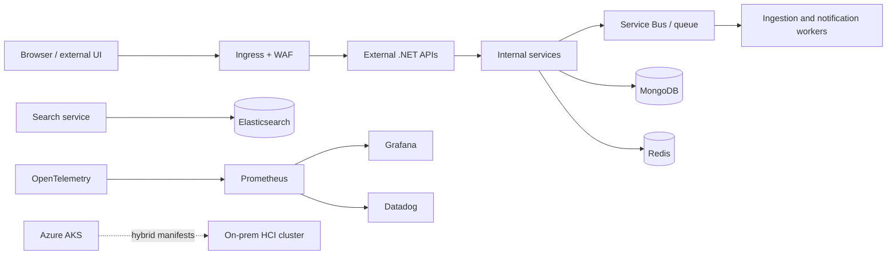

# Runtime flow

## Exposure model

External services are fronted by ingress and network policies. Internal services remain ClusterIP-only and are reached through service discovery. Worker services are scaled with KEDA from queue depth; request-driven APIs use HPA.

## Platform workload estimate

The 15 application services are deployed as separate workloads. Shared platform workloads include ingress, service mesh/telemetry, Redis, MongoDB, Elasticsearch, queue consumers, OpenTelemetry, Prometheus and Grafana. Production environments should use managed Azure services where appropriate and dedicated persistent volumes for stateful systems.
